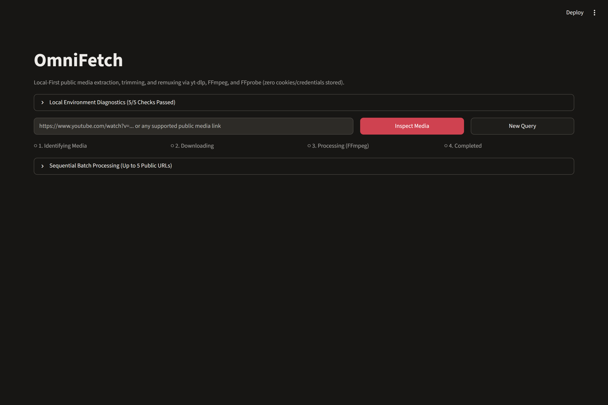
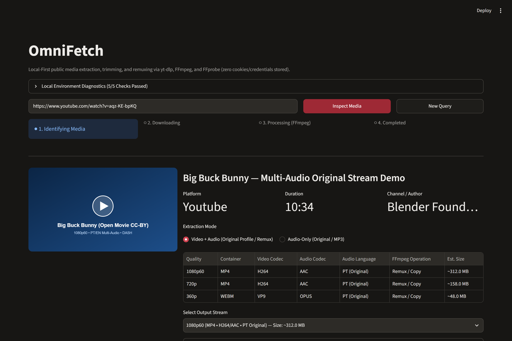
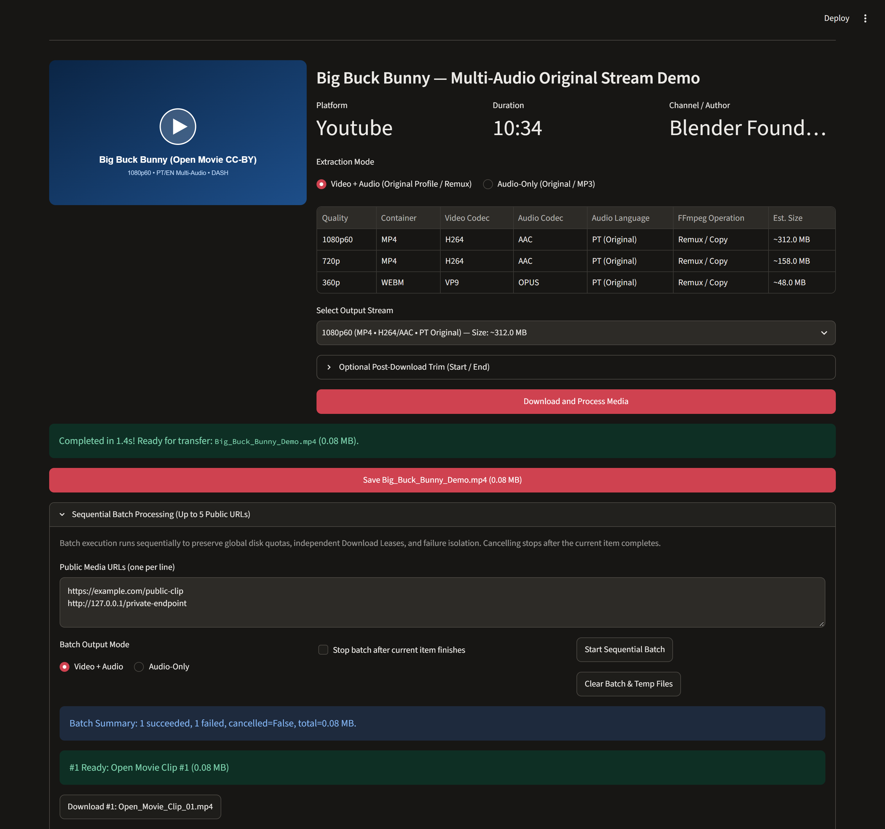

# OmniFetch

**LOCAL-FIRST MEDIA UTILITY**

A local-first media utility for inspecting, selecting, downloading, trimming, and processing public media streams supported by `yt-dlp`, backed by **FFmpeg** and **FFprobe**.

[](https://github.com/ledrodh/OmniFetch/actions/workflows/ci.yml)
[](pyproject.toml)
[](LICENSE)


| Core Capability | Summary |
| :--- | :--- |
| **Original audio priority** | Prioritizes creator original-language audio tracks over auto-dubbed tracks by default. |
| **Media trimming** | Post-download temporal trimming with fast stream copy (`-c copy`). |
| **Batch processing** | Sequential processing of up to 5 public URLs with failure isolation. |
| **Security controls** | Layered IPv4/IPv6 anti-SSRF validation, context-isolated DNS guard, and atomic resource limits. |

## Table of Contents

- [Screenshots](#screenshots)
- [Key Features](#key-features)
- [Requirements & Limitations](#requirements--limitations)
- [Installation](#installation)
- [Usage](#usage)
- [Architecture Overview](#architecture-overview)
- [Engineering Highlights](#engineering-highlights)
- [Quality Assurance](#quality-assurance)
- [Documentation](#documentation)
- [License & Responsible Use](#license--responsible-use)

---

## Screenshots

### 1. Main Interface
Landing screen showing environment prerequisite diagnostics (5/5 checks), public URL input, 4-stage pipeline status indicator, and sequential batch launcher.



### 2. Stream Inspection & Original Audio Selection
Extracted stream metadata table showing resolution, container, RFC 6381 codecs, automatic `PT (Original)` audio track selection, FFmpeg operation mode, and estimated output size.



### 3. Processing Output, Download Lease & Sequential Batch
Completed media download button backed by a Download Lease, alongside the sequential batch panel with independent per-item transfer controls and failure isolation.



---

## Key Features

### Media Extraction
- Public HTTP/HTTPS media inspection via `yt-dlp` without downloading upfront.
- Support for DASH, HLS, and progressive streams.
- Automatic original-language audio prioritization across multi-language streams.
- Normalized RFC 6381 codec display and accurate size estimation (including combined `video + audio` totals).

### Media Processing
- Lossless remuxing and DASH stream merging (`Original` profile via `-c copy`).
- Optional `H.264` + `AAC` `.mp4` re-encoding (`Compatibility` profile) and MP3 audio extraction without bitrate inflation.
- Post-download temporal trimming (`SS`, `MM:SS`, `HH:MM:SS`).
- Output verification via `FFprobe`.

### Batch Operations
- Controlled sequential execution of up to 5 public URLs.
- Failure isolation so one unavailable or SSRF-blocked URL never aborts the remaining batch items.
- Cooperative cancellation stopping gracefully after the currently running item completes.
- Individual lease-protected transfer buttons for each completed batch item.

### Security & Resource Management
- Layered IPv4/IPv6 Anti-SSRF filtering covering private networks, cloud metadata (`169.254.0.0/16`), NAT64, 6to4, Teredo, and ULA.
- Thread-safe, `ContextVar`-isolated DNS rebinding guard.
- UUID4-isolated temporary workspaces with symlink blocking and filename sanitization.
- In-process atomic global storage reservation (`max_global_workspace_bytes`) and reference-counted `Download Lease` protection.

---

## Requirements & Limitations

| Item | Requirement / Limit |
| :--- | :--- |
| **Python** | `3.10`–`3.13` |
| **FFmpeg & FFprobe** | Required on system `PATH` |
| **Network** | Internet connection required for remote streams |
| **Media Access** | Public streams supported by `yt-dlp` |
| **Maximum Output Size** | `2 GiB` per logical media output |
| **Maximum Operation Workspace** | `4 GiB` per individual operation |
| **Global Workspace Quota** | `8 GiB` shared across active sessions **within the same OmniFetch process** |
| **Batch Processing** | Up to `5` URLs, processed sequentially |
| **Live Stream Trimming** | Blocked (`is_live=True`) |
| **Credentials & Cookies** | Intentionally unsupported |

### Important Behavioral Notes
- **Temporal Trimming (Post-Download & Keyframe Precision):** In v1.1.0, OmniFetch downloads the complete selected media first and applies FFmpeg trimming locally (`-ss` / `-to -c copy`). Because stream copy does not re-encode frames, cut boundaries snap to the nearest keyframes rather than frame-exact positions.
- **Sequential Batch Execution:** Batch URLs are processed sequentially rather than in parallel to guarantee deterministic quota accounting, per-item Download Leases, and cooperative cancellation after the current item completes.
- **Process-Scoped Global Quota:** The `8 GiB` global temporary workspace limit uses an in-memory lock protecting concurrent sessions within a single running OmniFetch instance (without cross-process IPC).

---

## Installation

### Prerequisites
- Python `3.10`–`3.13`
- `FFmpeg` and `FFprobe` installed on `PATH`
- `Git`

### Windows (PowerShell)

Clone the repository:

```powershell
git clone https://github.com/ledrodh/OmniFetch.git
cd OmniFetch
```

Create the virtual environment and install pinned runtime dependencies:

```powershell
python -m venv .venv
.\.venv\Scripts\python.exe -m pip install --upgrade pip
.\.venv\Scripts\python.exe -m pip install -r requirements.txt -c constraints.txt
```

Verify FFmpeg availability:

```powershell
ffmpeg -version
ffprobe -version
```

Launch OmniFetch locally:

```powershell
.\.venv\Scripts\streamlit.exe run app.py --server.address=127.0.0.1 --server.port=8501
```

Open **http://127.0.0.1:8501** in your browser.

### Docker (Unprivileged Production Image)

Build and run the non-root (`UID 1000`) production container bound strictly to loopback:

```bash
docker build -t omnifetch:1.1.0 .
docker run --rm -p 127.0.0.1:8501:8501 omnifetch:1.1.0
```

Then open **http://127.0.0.1:8501**.

---

## Usage

1. **Startup Check:** On launch, OmniFetch validates Python, `yt-dlp`, `FFmpeg`, `FFprobe`, and writable temporary disk space (`>= 512 MiB` free) before enabling URL input.
2. **Inspect Single Media:** Paste a public URL and click **Inspect Media** to preview title, duration, normalized stream table, and automatically selected original-language audio.
3. **Select Format & Optional Trim:** Pick **Video + Audio** or **Audio-Only** (including bitrate-matched MP3), optionally enter **Start/End** timestamps (`MM:SS` or `HH:MM:SS`), and click **Download and Process Media**.
4. **Save Output:** Click **Save ...** to stream the artifact from its lease-protected temporary workspace.
5. **Sequential Batch & History:** Expand **Sequential Batch Processing** to queue up to 5 URLs (one per line) and download completed outputs individually, or view up to 20 recent operations in **Session History** (temporary in-memory FIFO cleared on restart).

---

## Architecture Overview

```mermaid
flowchart LR
    User["User"] --> UI["Streamlit Interface"]
    UI --> Validation["Validation & Diagnostics"]
    Validation --> Extraction["Metadata Extraction"]
    Extraction --> Selection["Stream Selection"]
    Selection --> Engine["Download Engine"]
    Engine --> FFmpeg["Media Processing"]
    FFmpeg --> Storage["File Management"]
    Storage --> Output["Download Output"]
```



- `app.py` — Streamlit UI, 4-stage state machine, temporary session history, and batch panel.
- `core/` — Immutable models, safe metadata extractor, original-audio selector, sequential/single downloader, and FFmpeg/FFprobe processor.
- `utils/` — Anti-SSRF validator & DNS guard, UUID4 workspace/lease manager, 8-category error handler, and startup diagnostics.

For module-level contracts and the full internal state diagram, see [docs/ARCHITECTURE.md](docs/ARCHITECTURE.md).

---

## Engineering Highlights

### Original Audio Prioritization
OmniFetch implements a codec-aware and language-aware stream selection strategy that prioritizes original-language audio over auto-dubbed tracks across DASH pairing, progressive vs. DASH deduplication, audio-only extraction, MP3 conversion, and `yt-dlp` format sorting. See [docs/MEDIA_PROCESSING.md](docs/MEDIA_PROCESSING.md) for ranking internals.

### Remuxing, Re-Encoding & Trimming Profiles

| Mode | FFmpeg Operation | Output Codecs | Speed | Best For |
| :--- | :--- | :--- | :--- | :--- |
| **Original (Default)** | Remux / Merge (`-c copy`) | Native (`H.264`, `VP9`, `AV1`, `AAC`, `Opus`) | Very Fast | Modern players with zero quality loss |
| **Compatibility** | Re-encode (`libx264` + `aac`) | `H.264` + `AAC` (`MP4`) | Slow (CPU) | Legacy hardware and strict video editors |
| **Post-Download Trim** | Input-seek copy (`-ss` / `-to -c copy`) | Preserves source streams | Very Fast | Quick keyframe-aligned extracts on non-live media |

### Security & Resource Isolation
- Layered URL, DNS, redirect, and manifest validation prevents SSRF and DNS rebinding attacks without requiring cookies or user credentials; see [docs/SECURITY.md](docs/SECURITY.md).
- Reference-counted Download Leases, `io.RawIOBase` chunked transfer streams, and lock-protected global quota reservations protect disk and heap resources across concurrent sessions; see [docs/MEDIA_PROCESSING.md](docs/MEDIA_PROCESSING.md).

---

## Quality Assurance

- **Automated Test Suite:** `126 passed` (unit, concurrency barrier, `RawIOBase` contract, `tracemalloc` memory benchmark, `AppTest` UI, and real FFmpeg/FFprobe + MPEG-DASH `.mpd` local E2E).
- **Code Coverage:** `96.7%` statement coverage and `93.2%` branch coverage across `core/`, `utils/`, and `app.py` (`95.9%` combined).
- **Static Checks:** `Ruff` lint & formatting + `Pyright` strict typecheck pass with zero errors.

Run locally with development dependencies:

```powershell
.\.venv\Scripts\python.exe -m pip install -r requirements-dev.txt -c constraints.txt
ruff check .
ruff format --check .
pyright
.\.venv\Scripts\pytest.exe --cov=core --cov=utils --cov=app --cov-branch --cov-report=term-missing --cov-fail-under=90
```

GitHub Actions (`.github/workflows/ci.yml`) automates this matrix across Python `3.10`–`3.13` plus a containerized `docker-smoke-test` verifying UID `1000`, `FFmpeg`/`FFprobe`, startup checks, and `/_stcore/health`. See [docs/TESTING.md](docs/TESTING.md) for module-by-module metrics.

---

## Documentation

| Document | Contents |
| :--- | :--- |
| [docs/ARCHITECTURE.md](docs/ARCHITECTURE.md) | Internal module boundaries, detailed Mermaid diagram, and state machine transitions. |
| [docs/SECURITY.md](docs/SECURITY.md) | Anti-SSRF IPv4/IPv6 defenses, context-isolated DNS guard, filesystem confinement, and test fixture isolation. |
| [docs/MEDIA_PROCESSING.md](docs/MEDIA_PROCESSING.md) | Stream selection ranking, original audio priority, FFmpeg profiles, trimming semantics, sequential batches, and `RawIOBase` leases. |
| [docs/TESTING.md](docs/TESTING.md) | Automated suite inventory, per-module line/branch coverage table, uncovered defensive branches, and CI workflow details. |

---

## License & Responsible Use

Distributed under the **MIT License** (see [LICENSE](LICENSE)). Users are solely responsible for complying with applicable copyright laws and platform Terms of Service.
