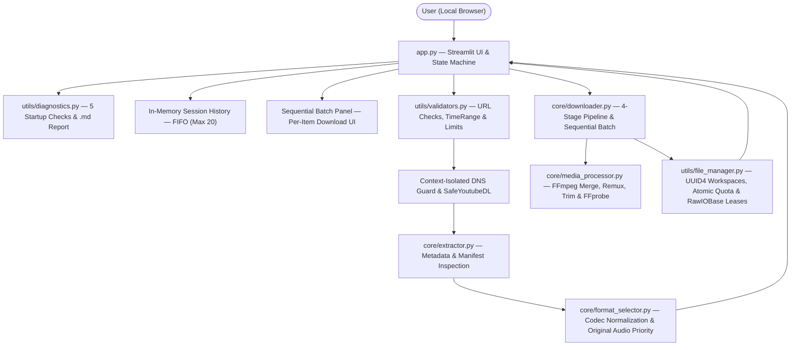
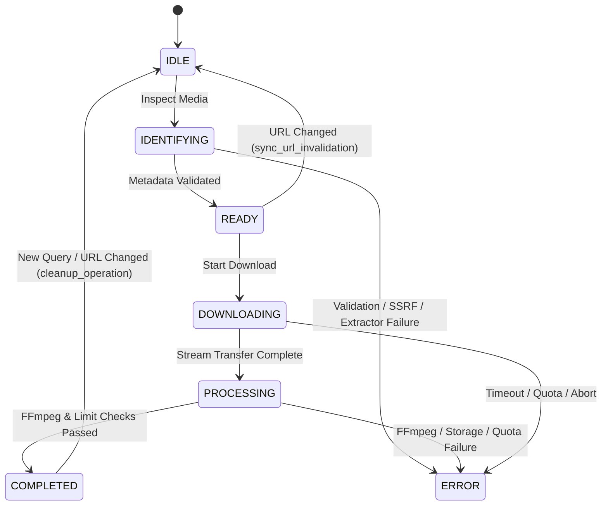

# System Architecture — OmniFetch

This document details OmniFetch's internal module layout, separation of concerns, state machine lifecycle, and full component interaction diagram.

---

## 1. Design Principles

1. **Strict Headless Engine Decoupling:** `core/` and `utils/` have zero imports from `streamlit`. All extraction, stream ranking, SSRF protection, FFmpeg configuration, atomic storage reservation, and batch orchestration can execute headlessly via Python or CLI.
2. **Immutable Data Contracts (`core/models.py`):** Data crosses layer boundaries using frozen `slots=True` dataclasses (`MediaMetadata`, `FormatOption`, `TimeRange`, `ProgressState`, `DownloadResult`, `SessionHistoryEntry`, `BatchSummary`, `StructuredError`).
3. **Fail-Closed Validation:** Prerequisites, URLs, DNS records, resource quotas, and output path containment are validated before network I/O or disk persistence.

---

## 2. Detailed Component Architecture

---

## 3. Module Responsibilities

| Module | Primary Responsibility |
| :--- | :--- |
| [`app.py`](../app.py) | Initializes `st.session_state`, enforces startup diagnostics gate, invalidates cached metadata on URL change, bridges 4-stage pipeline progress, and renders single/batch download controls + temporary history. |
| [`core/models.py`](../core/models.py) | Defines `DownloadMode`, `OutputProfile`, `OperationStatus`, `ErrorCategory`, `OperationalLimits`, `TimeRange`, `FormatOption`, `MediaMetadata`, `DownloadResult`, `SessionHistoryEntry`, and `BatchSummary`. |
| [`core/extractor.py`](../core/extractor.py) | Invokes `SafeYoutubeDL(skip_download=True)` with `format_sort=["lang"]`, unwraps playlists/multi-video entries, inspects every extracted stream/manifest/fragment/thumbnail URL for SSRF, infers `original_language`, and delegates format building. |
| [`core/format_selector.py`](../core/format_selector.py) | Normalizes RFC 6381 codecs (`h264`, `vp9`, `av1`, `aac`, `opus`, `mp3`), estimates byte sizes, pairs video-only DASH streams with the highest-ranked original-language audio stream, and ranks audio/MP3 options with original language first. |
| [`core/downloader.py`](../core/downloader.py) | Runs stage transitions (`IDENTIFYING` -> `DOWNLOADING` -> `PROCESSING` -> `COMPLETED`), enforces aggregate multi-stream byte accounting, reserves global workspace space atomically, executes sequential batches, and manages optional post-download trimming. |
| [`core/media_processor.py`](../core/media_processor.py) | Configures `yt-dlp` postprocessors (`FFmpegMerger`, `FFmpegVideoConvertor`, `FFmpegExtractAudio`, conditional `-movflags +faststart`), runs `trim_media_segment()`, `remux_media()`, and `probe_media_file()`. |
| [`utils/validators.py`](../utils/validators.py) | Validates HTTP/HTTPS syntax and IPv4/IPv6 public boundaries, coordinates thread-safe/context-isolated `guarded_dns_resolution()`, implements `SafeYoutubeDL`, parses/validates `TimeRange`, and provides `ConcurrencyGuard`. |
| [`utils/file_manager.py`](../utils/file_manager.py) | Sanitizes filenames, confines paths inside UUID4 directories, enforces symlink rejection, maintains in-memory + `.lease` Download Leases, implements `LeasedFileReader(io.RawIOBase)`, runs TTL sweeps, and guards the process-wide `_GLOBAL_RESERVATIONS` ledger. |
| [`utils/error_handler.py`](../utils/error_handler.py) | Defines 8 domain exception subclasses of `OmniFetchError`, maps raw `yt-dlp`/FFmpeg/OS errors via `classify_yt_dlp_error()`, and redacts ANSI codes, credentials, and signed query tokens via `sanitize_log_message()`. |
| [`utils/diagnostics.py`](../utils/diagnostics.py) | Runs 5 startup environment checks (`Python >= 3.10`, `yt-dlp`, `ffmpeg`, `ffprobe`, writable temp workspace with >= 512 MiB free) and builds path-free Markdown support reports. |

---

## 4. State Machine & URL Invalidation Lifecycle

Whenever `sync_url_invalidation()` detects that `source_url` differs from `last_inspected_url`, cached metadata and active temporary artifacts are purged immediately (`cleanup_operation`), while `session_history` remains preserved in memory for the active session.
